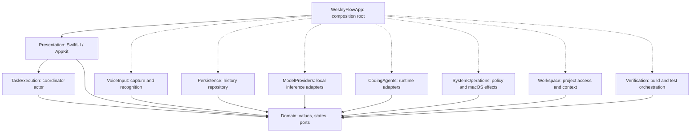
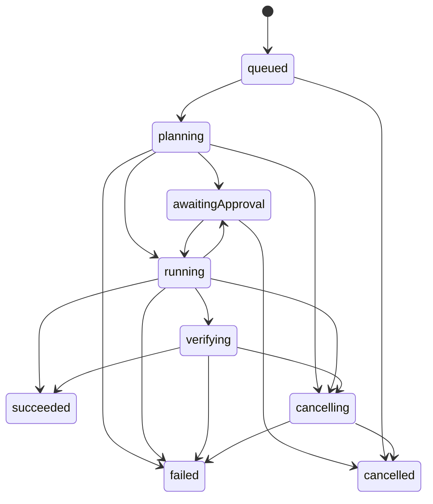

# Technical architecture

## Product and constraints

Wesley Flow is a native, local-first macOS 26+ application for Apple Silicon, designed first for a MacBook Air M4 with 16 GB unified memory. SwiftUI presents state; AppKit supplies macOS lifecycle and platform integration where needed. Use Swift 6 language mode and actor isolation. No web UI, cloud dependency, analytics service, or third-party framework is required for the foundation.

These are design boundaries, not implemented capabilities. Create concrete modules only when their first behavior and tests are introduced. Start with an application target and a local Swift package containing Domain; do not generate empty targets for this entire diagram.

## Dependency diagram

Arrows mean compile-time dependency. Dashed arrows show eventual composition. Domain has no dependency on Apple UI, persistence, model SDKs, or process APIs.

TaskExecution consumes Domain ports implemented by adapters. Verification requests process execution through the same permission-controlled port as other operations. Coding-agent adapters cannot import a privileged system executor. The composition root supplies a task-scoped broker and connects voice transcripts to task submission. VoiceInput never receives an execution capability.

## Responsibilities and ownership

| Boundary | Responsibility |
|---|---|
| Domain | Sendable identifiers, requests, state transitions, typed errors, permission scopes, events, dependency protocols |
| Presentation | MainActor observable view state; user input and approval UI; no blocking work or privileged effects |
| TaskExecution | Actor-owned task lifecycle; planning, approval suspension, execution, cancellation and terminal result |
| VoiceInput | Audio session/capture lifecycle and transcription; emits transcript values; no command execution |
| SystemOperations | Permission broker, canonicalized path access, process management, macOS automation adapters |
| Workspace | User-selected project roots, bounded file/context discovery, proposed patches and conflict checks |
| ModelProviders | Capability discovery, local loading, inference stream, cancellation and unload |
| CodingAgents | Runtime-specific sessions and normalized tool requests/events; no UI or direct authority |
| Verification | Explicit verification plan, build/test execution, result parsing and evidence |
| Persistence | Serialized history writes, schema versioning, bounded event retention and recovery |

Proposed ports include SpeechRecognizer, ModelProvider, CodingAgentRuntime, TaskHistoryRepository, WorkspaceAccess, SystemOperationBroker and VerificationRunner. These are conceptual contracts; add Swift protocols only with a consumer and test. Do not force native framework objects across concurrency boundaries: adapters convert to Sendable values. Separate pure state transitions from persistence and effects.

## Task lifecycle

An executing task can pause before a newly discovered effect. Denial cancels the task with a structured reason. A task with no verification requirement may succeed directly; all other tasks require recorded verification evidence. Verification failures produce failed, never succeeded-with-hidden-errors. Terminal states cannot resume. Retry creates a new task linked to its predecessor. Timeout is a typed failure. Cancellation stops new effects, revokes task authority, requests provider/process cancellation, and waits for bounded cleanup. Cleanup failure becomes failed and identifies any surviving process or partial effect. Cancellation cannot undo prior edits or external effects.

Persist an ordered task event and corresponding state atomically before acknowledging transitions. For an external effect, persist intent first and outcome afterward. No atomicity is claimed between filesystem/process effects and history. An incomplete intent after restart is marked uncertain/interrupted and requires inspection; it is never replayed automatically. Nonterminal tasks on startup become interrupted failures with their previous state retained. Approval is never restored across restart.

Each task has an ID; events have per-task sequence numbers, timestamps, phase, operation ID and bounded payload. Durable semantic events are distinct from lossy/coalesced UI progress. Never drop an approval, operation outcome, or terminal event. Stream transient token/progress output with bounded buffers and backpressure; persist summaries and selected artifacts instead of every token.

## Concurrency and resource policy

TaskCoordinator actor owns state and one structured execution task per active request. MainActor owns UI state. A history actor owns persistence context. Adapters isolate non-Sendable framework state. Long-lived audio callbacks feed bounded streams; no audio or token work blocks MainActor. Avoid detached tasks, shared mutable singletons and unchecked Sendable.

Initially permit one executing task and one loaded inference model. Audio capture and transcription may coexist only after memory and latency measurements. Providers advertise capabilities, context limits, model identity, estimated memory and cancellation support. Reject unsupported requests explicitly. Load lazily and unload on demand or pressure. Set budgets after measurements on the target M4/16 GB machine; do not promise model sizes or speed. A future fine-tuned model is a model artifact plus provider capability/format validation, not a new coordinator or agent runtime. Training is outside this scope.

Coding runtimes are independent of inference providers. Normalize tool requests through the broker. If a runtime requires unrestricted native execution, it cannot be presented as permission-contained; defer it until its execution and containment model is approved. Initial integration should select a runtime with brokerable effects.

## Storage and error behavior

Use SwiftData behind TaskHistoryRepository for metadata and durable events. Keep framework model classes within the persistence actor. Store bounded logs/patches as files in Application Support with references, size limits, retention and deletion. No project source copies or audio recordings by default. Keep transcripts in memory unless users opt into storing them. Schema migrations are explicit and tested when introduced. A failed history write blocks new side effects and surfaces a recoverable error; never silently discard evidence. Stage artifact writes and use atomic replacement; detect missing/orphaned artifacts on recovery.

Typed errors preserve phase, safe user message, retryability and underlying diagnostic reference. Handle permission denial, missing model, exhausted memory, runtime crash, invalid patch, build failure, timeout, persistence failure and cancellation distinctly. Diagnostics redact secrets and content by default. Task completion includes what changed, verification actually run, exit status and remaining limitations.
