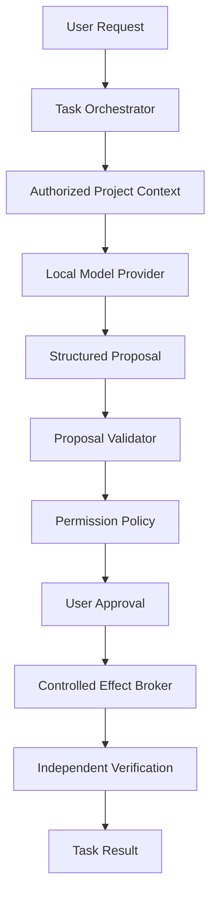

# Phase 1B architecture — proposal-only local inference

19 October 2026 · Architecture adopted by explicit Phase1B.2A finalization request. Original adoption was documentation only; see the current implementation status below. No effect broker is activated. Supersedes the original OpenCode-first delivery recommendation; historical design and execution evidence remain in Git history and the completion reports.

## Decision and flow

Adopt **proposal-only local AI inference**. Keep OpenCode execution disabled. The tested native helper configuration is insufficient for Wesley Flow's complete general-purpose execution requirements; App Sandbox did enforce tested restrictions. See [containment ADR](ADR-EXECUTION-CONTAINMENT.md) and [feasibility evidence](PHASE1B2A-SECURITY-FEASIBILITY.md).

This is the future product flow, not a description of active implementation. Context disclosure also needs prior explicit scope/consent. Validation failure or policy denial stops before approval/dispatch. User approval alone cannot override failed validation. Post-approval preconditions are checked again at dispatch. The model can return data only: no executable command fields, direct filesystem writes/deletes, arbitrary subprocesses, permission expansion or self-approval.

## Module and authority direction

App composes concrete adapters. Presentation imports Domain/TaskExecution; TaskExecution imports Domain only. CodingAgents, Workspace, SystemOperations, ModelProviders, Verification and Persistence each import Domain only. Domain imports no vendor, UI, process or persistence framework. Do not add empty targets. Phase1B.3A implements the replaceable LocalModelProvider Domain port and populated ModelProviders target. Ollama remains an adapter, not a Domain dependency; model admission restrictions belong to that adapter.

Workspace owns pure proposal validation and context/snapshot normalization. Trusted SystemOperations owns root handles and actual authorized read/write effects; a snapshot contains identities and digests, not a reusable root capability. ModelProviders owns bounded transport, exact artifact identity, one inference lease and cancellation/resource accounting. It receives reviewed bytes, never an executor, grant issuer, bookmark or raw host-root handle. Verification independently checks broker receipts and observed post-state. Adapter calls pass through Domain ports injected by App, never cross-adapter imports.

## Retained foundation

Keep the nine-state/13-event TaskLifecycle graph, 117-pair/27-edge oracle, one-active/FIFO16 coordinator, atomic state/event persistence and sequence CAS, interrupted recovery, generation/deadline fencing and private approval issuer. PermissionBroker currently rejects productive file/process/automation operations and stays unchanged. Public OperationToken and runtime/proposal identifiers remain identity only, not unforgeable dispatch authority. AppComposition still exposes no operational provider/effect UI.

Preserve CodingAgentRuntime, fixture HTTP/SSE parsers, bounded queues, foreign/duplicate checks, actor lifecycle/cancellation tests and pinned OpenCode1.18.25 schema references as **disabled optional infrastructure**. No OpenCode launcher, live session, provider gateway or model engine becomes a prerequisite for the direct proposal path. Generic limits/correlation principles may be reused through deliberately consumed Domain contracts, without pretending OpenCode wire events are the new proposal schema.

## Proposal and revision contracts

[PROPOSAL-CONTRACTS.md](PROPOSAL-CONTRACTS.md) defines the implemented1B.2B version1 data values and pure decoder/validator behavior. A proposal is not an accepted plan, permission, effect receipt or verified result. Separate bounded proposal tasks from separately approved immutable application tasks. Proposal-only completion means **proposal prepared**, never code edited or tests passed.

Before edits, add a narrowly scoped versioned coding-plan/receipt contract with canonical descriptor digests, base and expected per-step post-snapshots and independently observed final snapshot. Preserve existing TaskPlan decoding and its fixed-revision semantics; never mutate an admitted plan or relabel an edited tree as the old base. Domain/TaskExecution integration and persistence migrations require 1B.4 authorization and tests. No file broker is implemented or activated by this revision.

Actor-owned mutable sessions/resources; Sendable values across boundaries; explicit MainActor UI. Preserve Swift tools6.2, Swift6 language mode, 6.2.3 compiler floor and macOS26 arm64 deployment. Swift6.4/Xcode27beta evidence does not close actual macOS26 or older-compiler compatibility gates.

## Decision reconciliation

| Earlier ID | Current disposition |
|---|---|
| 1B-D01 native V1 HTTP/SSE primary | Retained fixture/optional adapter; superseded as primary inference delivery path |
| 1B-D02 isolated OpenCode worker | Live execution remains disabled; proposal-only direct provider adopted |
| 1B-D03 separate proposal/application tasks | Retained, with immutable revision chain before effects |
| 1B-D04 runtime-to-provider gateway | Not required by current direct provider path; one trusted provider lease retained |
| 1B-D05 independent evidence | Retained; command execution separately blocked on containment |

The new ADR selects reduced authority, not an approved general execution mode under Phase0 ADR008. Host build/test commands over generated projects remain blocked until separately established and tested subprocess containment. No implicit unrestricted-host fallback. Follow [milestones](IMPLEMENTATION-PLAN.md), [security](SECURITY-BOUNDARIES.md), [lifecycle](TASK-LIFECYCLE.md), [provider](MODEL-PROVIDER.md), [gates](TEST-AND-ACCEPTANCE.md), [risks](RISKS.md) and [pivot report](ARCHITECTURE-PIVOT-REPORT.md). Each later milestone still requires separate implementation authorization.

## Phase1B.2B implementation status

A populated Workspace target now implements pure proposal decoding, SHA256 identity and validation against injected snapshots/policy; it imports Domain plus Foundation/CryptoKit only. Domain contains the ten proposal values. The app does not wire Workspace into a productive feature, and no provider, real read context, broker or verifier is activated. Existing Phase1A/1B.1 source and behavior remain unchanged. See [completion report](PHASE1B2B-COMPLETION.md);1B.2C requires separate authorization.

## Phase1B.2C read-only implementation

SystemOperations now owns ReadOnlyWorkspaceBroker, an actor implementing the Domain ProjectRegistry and WorkspaceObservationSource ports for explicitly injected local fixture roots. WorkspaceSnapshotBuilder and ContextAssembler consume those ports; neither imports SystemOperations nor opens source files. Domain contains immutable Sendable observation data and a conservative context allowlist. Package dependencies and app composition are unchanged. No provider, productive effect broker or real-project UI is wired. See [completion and limitations](PHASE1B2C-COMPLETION.md). Root registration and read observation are distinct from file-modification authority; the existing permission broker still rejects productive operations. Later context disclosure requires explicit review/consent and provider-specific resource/token gates.

## Phase1B.3A provider foundation

Domain adds inert inference requests/responses/errors/cancellation/resource observations and a proposal-preparation port. ModelProviders implements loopback-only nonstreaming Ollama0.33.0 transport with bounded responses, explicit deadlines, one process-wide WF inference lease, memory admission and uncertainty quarantine. Workspace ProposalGenerator performs strict existing proposal decoding/validation; TaskExecution ProposalTaskExecutor adapts a single inspection-only generation through the existing coordinator. No productive operation or new persistence framework is introduced. SystemOperations owns native memory observation. All these production adapters depend only on Domain.

The developer-only OllamaEvaluation executable is a leaf composition root over Domain/ModelProviders/Workspace/SystemOperations and a frozen synthetic corpus. It is not linked into the application. Test composition imports concrete adapters deliberately. AppComposition and prior source/tests are unchanged. Live model generation was blocked by conservative memory admission on the measured host workload; fixture success is not live inference, cancellation, unload or OS isolation evidence. See [the3A report](PHASE1B3A-COMPLETION.md). No model is selected for production and later milestones require separate authorization.
