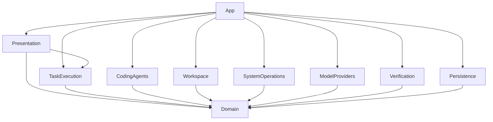

# Phase 1B architecture

19 October 2026 · Design proposal, documentation only · Baseline `686a0af7aebdfb270ef3cfefc51ecb703d017e4a`.

## Decision and scope

Recommend a small native Swift HTTP/SSE adapter for the installed **OpenCode V1 1.18.25**, behind a vendor-neutral CodingAgentRuntime port. Wesley Flow remains the task/approval/effect/verification authority. OpenCode is an untrusted proposal producer. Its native tools must never operate on the host checkout. Start with deterministic transport fixtures; enable a live runtime only after isolated execution and configuration behavior are proven. This design does not authorize implementation or select unrestricted host execution.

Default live architecture: an isolated worker with an ephemeral, explicitly selected context snapshot; no host project/home mount, credentials, SSH agent, shared clipboard or arbitrary network. A verified sandboxed helper is a candidate for proposal-only work; a VM is the conservative fallback when native OpenCode cannot be confined. VM performance on 16 GiB is unproven. If neither passes containment/resource gates, keep OpenCode disabled and evaluate a small direct Ollama proposal adapter with no native tool engine under separate scope. A network client is a transport, not a sandbox.

## Existing implementation to retain

Inspected root AGENTS, approved Phase 0 architecture/ADRs/security/development/environment/testing/plan, amendment traceability/consistency/risks, Phase1A completion/audit/remediation, actual Domain/coordinator/repository/broker/composition and test assertions. Historical audit HOLD was superseded for A1–A5 by remediation; real execution gates were not closed by remediation.

| Current component | Reuse and limitation |
|---|---|
| Domain TaskLifecycle/TaskTransitions | Nine states, 13 event kinds, 117 state/event pairs, 27 allowed pairs; retain the graph and guards |
| TaskCoordinator | One active task, FIFO 16 waiting, durable intent/outcome ordering, exact approvals, monotonic deadlines, generation fencing, bounded shutdown; no dynamic planning loop today |
| TaskHistoryRepository / SwiftDataTaskRepository | Explicit atomic state+event saves, CAS sequence, single writer, preserved corrupt/unknown stores; no source artifact or agent-session schema yet |
| TaskPermissionPolicy / PermissionBroker | Private trusted UI issuer; one-use task/operation/digest/revision/session/generation/expiry checks; currently rejects fileWrite/process/automation |
| TaskOperationExecutor / TaskVerificationRunner | Injected ports suitable for trusted broker and independent verifier; current token is identity, not an unforgeable effect capability |
| AppComposition | Constructs explicitly injected services; does not enable a live executor, provider, operational task UI or approval UI |

Existing tests include independent lifecycle oracle, exact/expired/revoked grants, save fault/reopen, unresolved cancellation disposition, deadline boundaries without timer delivery, stalled real-store shutdown, duplicate admission and observer release. They do not test OS containment or a coding runtime.

## Module direction

Keep the approved compile-time allowlist. App composes concrete adapters; Presentation imports Domain/TaskExecution; TaskExecution imports Domain only. CodingAgents, Workspace, SystemOperations, ModelProviders, Verification and Persistence each import Domain only. Domain imports no UI, process, persistence, vendor or model framework. Create populated targets only when first consumed/tested.

Runtime calls across ports are distinct from imports: coordinator requests a proposal; Workspace validates it; trusted broker dispatches the approved effect; Verification requests broker-controlled commands. App injects these ports. CodingAgents gets no executor, grant issuer, security-scoped bookmark or raw host root handle. ModelProviders owns inference transport; the runtime cannot silently choose another provider.

## Proposed narrow ports and values

Names below describe future contracts, not installed APIs or implemented protocols. Define them in Domain only when consumed:

- CodingAgentRuntime: create an owned session from a bounded context manifest and model identity; propose with a deadline; observe bounded events; request cancellation; return a cleanup assessment. Never execute a host operation.
- ProjectRegistry: register/revalidate an explicit selection, return opaque project identity plus trusted snapshot metadata. Workspace owns selection/context/patch validation; SystemOperations owns filesystem authority.
- OperationDescriptor: canonical versioned typed read, patch or executable/argv request; immutable preconditions, expected outputs, policy digest and limits. Never arbitrary model JSON passed directly to a process.
- EffectAuthority/EffectReceipt: broker-only one-use dispatch capability and actual per-file/process disposition. Revoke by session/generation; after every await recheck before effects. No public initializer that turns an OperationToken into authority.
- ModelProvider: capabilities, identity, resource lease, bounded generation stream, cancel/unload assessment; see [provider contract](MODEL-PROVIDER.md).
- VerificationPlan/EvidenceManifest: user-approved commands, exact input/output revision, toolchain, actual exits, test discovery/counts, artifact hashes and cleanup assessment.

Actor-owned mutable sessions/registrations/resources; Sendable values only across boundaries. URLSession/Process/SwiftData/vendor objects stay adapter-private. UI and approval gestures stay MainActor. Preserve Swift tools 6.2/mode 6 and compiler 6.2.3 floor; the currently available Swift 6.4 lane alone proves no floor compatibility. No concurrency suppressions or uncontrolled detached work.

## Immutable plans and revision progression

Do not hide an unrestricted multi-operation loop inside one inspection executor. Current TaskPlan.validate requires every operation to share one workspace revision and freezes the step list. Current completion compares observed revision to that same value. A real edit changes the content revision; lying about the revision would defeat verification.

Use a bounded proposal task followed by a separately reviewed immutable application task. Additional context requests become separately scoped operations/tasks, not nested self-authorization. Proposal completion means a proposal exists, never that code was changed or verified. Workflow family links and shared limits prevent resetting budgets with child tasks.

Before productive work, add a versioned coding-plan envelope with base snapshot, canonical descriptor digests, deterministic expected per-step post-snapshots and final verification snapshot. Preserve the old TaskPlan decoding/behavior. Trusted Workspace computes expected hashes from the proposed patch; broker receipts establish actual progression. Coordinator must compare each receipt with its step's expected post-snapshot and verification with the final snapshot. Never mutate an admitted plan, relabel post-edit state as the base revision, or globally weaken revision checks. This limited revision/evidence extension needs its own ADR, migration tests and authorization in 1B.2/1B.4; it is not needed for 1B.1 fixtures.

## Decision records proposed by this packet

| ID | Decision | Revisit trigger |
|---|---|---|
| 1B-D01 | V1-pinned native HTTP transport; no SDK or V2 mixing | Installed runtime changes or captured schema incompatible |
| 1B-D02 | No native runtime host-project effects; isolated proposal worker | Demonstrated isolation and execution-mode approval, never prompts alone |
| 1B-D03 | Separate proposal/application tasks and immutable revision chain | A measured need for dynamic plans, with full authorization/recovery design |
| 1B-D04 | One inference lease and explicit provider gateway for runtime inference | Measured replacement/throughput need within the same budget |
| 1B-D05 | Independent revision-bound evidence decides coding completion | Never replace with agent narrative |

These are recommendations for acceptance, not retroactive edits to approved ADRs. The execution-mode ADR required by Phase0 ADR008 remains a blocker until separately accepted and verified. Read [integration](OPENCODE-INTEGRATION.md), [security](SECURITY-BOUNDARIES.md), [lifecycle](TASK-LIFECYCLE.md), [milestones](IMPLEMENTATION-PLAN.md), [gates](TEST-AND-ACCEPTANCE.md), [risks](RISKS.md) and [report](PHASE1B-DESIGN-REPORT.md).
