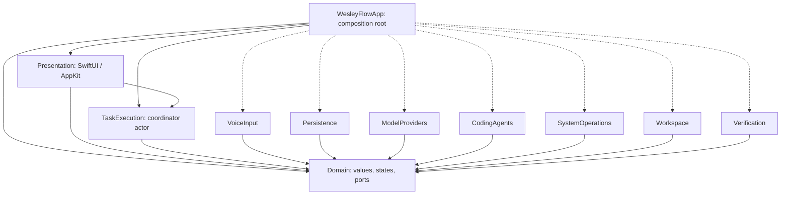
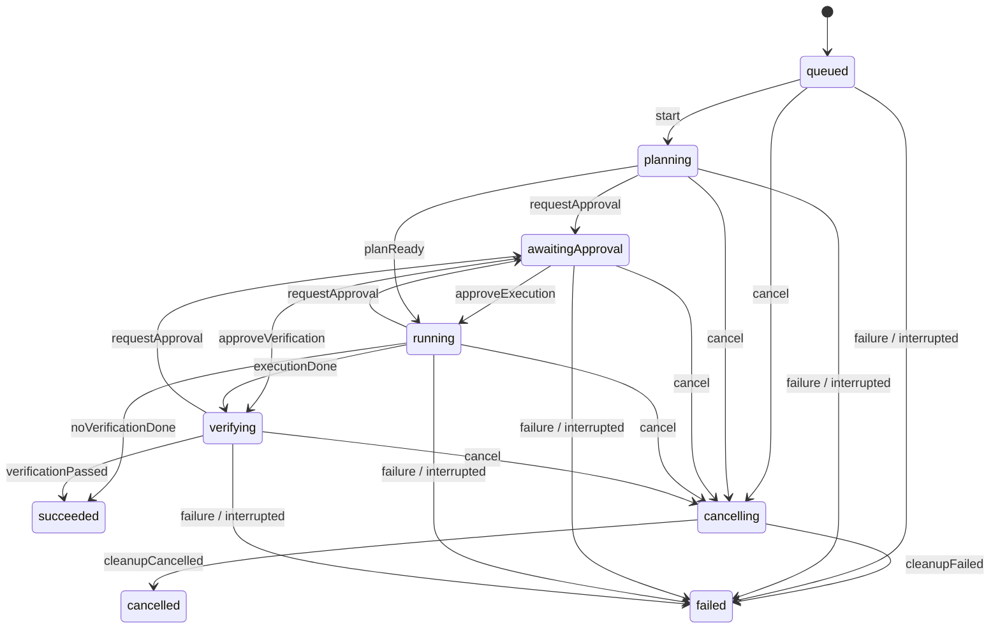

# Technical architecture

## Product and constraints

Native, local-first macOS 26+ Apple Silicon application, first targeting MacBook Air M4/16 GB. SwiftUI presents state; AppKit handles macOS integration. Swift 6 language mode and the compiler/SDK contract in [ENVIRONMENT](../ENVIRONMENT.md#compatibility-contract) apply. Offline dictation, replaceable inference and coding runtimes, and sequential DailyOps-style workflows are future features. Typed input and the shell require no large model. Fine-tuning/distillation, datasets and training infrastructure require a separate proposal; compatible future model artifacts use the same provider boundary.

Every statement below is a design requirement, not an implemented capability. Start with an app target and local package containing Domain; create other targets only with their first behavior and tests. No legacy application source reuse.

## Dependency diagram

Solid arrows mean allowed compile-time dependency; dashed composition edges become real imports when targets exist. They confer no execution authority. Domain has no framework, persistence, inference SDK or process dependencies.

### Dependency allowlist

| Target | Allowed internal dependencies |
|---|---|
| App | Domain, Presentation, TaskExecution and implemented adapters |
| Presentation | Domain, TaskExecution |
| TaskExecution | Domain |
| VoiceInput, Persistence, ModelProviders, CodingAgents, SystemOperations, Workspace, Verification | Domain only |
| Domain | None |

External platform/SDK imports are confined to their owning adapters or presentation. Domain may use standard value/concurrency facilities, never SwiftUI, AppKit, SwiftData, Speech, model SDKs or process APIs. SDK configuration stays in its adapter. As targets arrive, compare actual package/project target dependencies and imports with this allowlist; reject cycles or extra edges without an ADR. Initial composition may live in App until Presentation exists.

TaskExecution consumes narrow Domain ports implemented by adapters. Verification proposes process operations through the broker port. CodingAgents only propose normalized operations; they never receive an executor or grant-issuance capability. Workspace discovers context and validates/proposes patches; SystemOperations owns broker-enforced reads/writes/process effects. Workspace receives only a scoped broker-mediated read capability, not unrestricted writes. App wires ports rather than adapters importing each other. VoiceInput receives no operation capability.

## Responsibilities and ownership

| Boundary | Owns |
|---|---|
| Domain | Sendable requests, IDs, pure transitions, errors, permission/workflow values and narrow consumer-driven ports |
| Presentation | MainActor view state, trusted user gestures, approval rendering; no blocking effects |
| TaskExecution | Task lifecycle, sequential workflow traversal, operation/generation tokens and resource leases |
| VoiceInput | macOS capture/recognition state, final/volatile segments; transcript values only |
| SystemOperations | Policy, one-use grants, filesystem effect dispatch, child ownership and macOS automation |
| Workspace | Selected roots, context selection, proposed patches, original hashes and conflict detection |
| ModelProviders | Capability discovery, identity, load/infer/cancel/unload, memory estimate |
| CodingAgents | Runtime session and normalized requests/events; no independent native execution |
| Verification | Revision-bound verification plans, result parsing/evidence; effect dispatch through broker |
| Persistence | Actor-owned durable state/events, schema, artifacts, retention and recovery |

Add actual protocols only with a production consumer and test. Framework objects stay inside their isolated adapter and are converted to Sendable values. Mutable services are actor-owned, core defaults nonisolated, UI explicitly MainActor. Pure transitions are separate from effects/persistence.

## Task lifecycle

### Transition table

The diagram and this table are the same graph. Unlisted state/event pairs and failed guards are rejected without effects. The finite event set is exactly the event names in this table; every state/event pair must be tested. `failure` and `interrupted` are distinct events sharing destinations.

| From | Event | To | Guard / meaning |
|---|---|---|---|
| queued | start | planning | FIFO head, coordinator lease acquired |
| planning | requestApproval | awaitingApproval | Pending exact operation; resumePhase=running |
| running | requestApproval | awaitingApproval | No active effect; resumePhase=running |
| verifying | requestApproval | awaitingApproval | No active effect; resumePhase=verifying |
| awaitingApproval | approveExecution | running | Valid one-use grant; resumePhase=running |
| awaitingApproval | approveVerification | verifying | Valid one-use grant; resumePhase=verifying |
| planning | planReady | running | No pending approval; planning complete |
| running | executionDone | verifying | Immutable plan requires verification; execution steps complete |
| running | noVerificationDone | succeeded | Plan explicitly requires no verification; steps complete |
| verifying | verificationPassed | succeeded | Required evidence committed; exact workspace revision matches |
| queued, planning, awaitingApproval, running, verifying | cancel | cancelling | Revoke immediately; terminalIntent is cancelled or failed with typed cause |
| cancelling | cleanupCancelled | cancelled | terminalIntent=cancelled; cleanup confirmed complete |
| cancelling | cleanupFailed | failed | terminalIntent=failed or cleanup deadline/survivor failure |
| queued, planning, awaitingApproval, running, verifying | failure | failed | Setup, approval expiry/revocation, timeout, execution/verification/storage failure; cleanup already complete or no owned resources |
| queued, planning, awaitingApproval, running, verifying | interrupted | failed | Startup recovery only; old session revoked, prior state retained, effects marked uncertain |

A failure while resources are owned uses `cancel` with terminalIntent=failed, followed by `cleanupFailed` even if cleanup succeeds; the typed failure cause is preserved. Denial uses `cancel` with terminalIntent=cancelled. Approval expiry/revocation becomes typed failure (with cleanup if necessary). There is no direct approval-to-cancelled shortcut. Terminal states succeeded/failed/cancelled are immutable. Retry creates a new task linked to its predecessor and requests new approval. Timeout uses the same revocation/cleanup policy as failure. A restart found in cancelling records `cleanupFailed` with typed interruption cause and previous state retained; recovery never resumes work.

Normal state+event transitions commit together before acknowledgement. Effects persist sanitized intent before dispatch and outcome after completion. No transaction spans a database and an external effect. On write failure, prohibit new effects; revoke and clean up immediately without waiting for database recovery. Show an uncommitted failure in memory; reconcile the last durable intent on restart. Never silently discard evidence or report a durable terminal state before its commit. Emergency cleanup is an exception to write-before-transition, not permission for new productive effects.

Events carry task ID, unique per-task sequence, operation ID, generation, timestamps, phase and bounded sanitized payload. Durable semantic events (approval decision, intent, outcome, terminal) cannot be treated as droppable progress. Token/UI progress uses bounded buffers/backpressure and coalescing; do not persist every token. Uncertain intents always require inspection, never automatic replay or grant restoration.

## Workflow and orchestration contract

A versioned workflow value contains workflow ID/version, ordered step IDs/types, bounded typed inputs, approval checkpoints and required verification. Submission captures an immutable snapshot and workspace revision. Initially steps run sequentially, with one active operation; editing creates a new workflow version, never mutates in-flight work. Retry creates a linked task; completed/uncertain steps are not automatically replayed. Resume across restart is unsupported. Partial completion reports completed, failed and uncertain step IDs.

One executing task globally; FIFO queue holds at most 16 waiting tasks. The 17th waiting submission is rejected visibly before acceptance/effects, without silently dropping work. Cancelling queued work removes it and commits its cancellation; it cannot start later. A workspace lease keyed by resolved root prevents simultaneous writes/verification by this app, including aliases/nested roots. External editors are not locked: recheck hashes/revision before each write and verification; changes cause conflict/reapproval. Verification records the revision it tested and fails as stale if relevant files change during the run.

Initial agent limits per task: 20 planning/inference turns, 50 proposed tool requests, 2 retries per failed step (no hidden reset), 15 minutes total execution excluding approval waits, 5 minutes per process, 5 minutes per approval request, and output/context caps selected under the model budget. Limits are maxima, can be lowered by policy, and cannot be raised by model/project text. Exhaustion fails with a typed limit reason and bounded cleanup; human continuation creates a new linked task. No unbounded recursive workflows.

## Cancellation and subprocess ownership

Coordinator owns one structured execution task and resource lease; broker owns each child's task/operation/session identity, process group, descriptors and cleanup state. Recheck task state, generation, operation token and grant validity after every suspension and immediately before effects; increment generation on revocation/cancel/retry to reject late results. Actors can reenter while awaiting. Late model/tool callbacks cannot mint grants, commit success or release another operation's lease.

Stop new dispatch, revoke grants, cancel streams, then request provider/child termination. Drain stdout and stderr concurrently with bounded buffers; capture at most 1 MiB combined per operation, then truncate with byte counts while continuing to drain. Graceful termination gets 2 seconds; escalation gets 3 more. By 5 seconds ordinary fixture descendants must be gone; otherwise report survivors and failed cleanup. Retain/quarantine leases while ownership is uncertain, allowing status/cleanup UI but no new conflicting task. Process groups are best effort; detached/escaped children are not proven contained.

Provider cancellation/unload must acknowledge within the same 5-second cleanup budget. A noncooperative adapter is disabled/quarantined; do not await indefinitely or pretend an in-process task can be killed safely. Stronger termination needs a separately justified process boundary. App quit cancels and waits only the bounded budget, reports uncertain cleanup, and preserves intent for next-start inspection.

## Speech readiness and submission

Use macOS AVAudioEngine/capture permission behavior; do not assume iOS AVAudioSession. Evaluate SpeechAnalyzer/SpeechTranscriber first for each selected device/locale, with separate supported/installed checks. Assets may require explicit online provisioning; progress, cancel, failure, missing and revoked states are visible. No online transcription fallback. Evaluate a supported on-device DictationTranscriber, then SFSpeechRecognizer only with on-device support and requiresOnDeviceRecognition enabled; otherwise typed input remains available. A bundled engine needs a dependency/resource ADR and tests before use. No provider is selected as proven here.

Stop finalizes accepted speech; cancel discards unsubmitted content and stops capture. Volatile segments replace earlier ranges, never append duplicates. Transcript text is editable data. Dictation does not submit a task; an explicit user action submits the reviewed text. Cross-app insertion is a separate approved effect; voice-controlled automation must still cross the human approval boundary in SECURITY. No spoken/project/website text can grant authority.

## Model resource policy

Core shell, typed submission, state/history and bounded non-AI operations must work with no inference model loaded. ModelProvider and CodingAgentRuntime remain independent. Providers advertise identity/artifact hash, format/license, capabilities, context/output limits, estimated peak footprint, cancellation and unload support. Unsupported requests fail explicitly. Replacement requires the same contract gates, not coordinator changes.

Adopt provisional **8 GiB aggregate measured incremental footprint** for app, inference worker/GPU allocations, system speech and tool children, plus **at least 4 GiB estimated system headroom at admission** on M4/16 GB. These are design limits, not benchmarks or promises. Record measurement method/baseline and uncertainty; do not double-count shared allocations or omit out-of-process speech. If headroom cannot be estimated credibly, reject/defer heavy work. Critical pressure stops heavy admission immediately; pressure persisting 2 seconds cancels/unloads heavy work within the 5-second cleanup budget. Define pressure source/threshold in the engine ADR; quarantine on failed cleanup.

Budget weights, quantization metadata/overhead, maximum-context KV cache, scratch/prefill/load peaks and output buffers. Raw 4-bit weights for 8B/14B are approximately 4/7 decimal GB before overhead, not fit guarantees. No core capability requires those sizes. One lazy-loaded model lease; unload before memory-heavy verification. Serialize speech and inference until measured coexistence passes. Cap context/output before admission; over-budget requests are deferred or rejected visibly, not silently paged into acceptance.

Before accepting an engine/model: fixed 30-minute target-machine workload, fresh baseline, warm/cold load, maximum context, cancellation, unload and repeated cycles; record aggregate peak, swap delta, pressure, thermal state, load latency, first-token latency, tokens/s and task quality. No OOM or sustained critical pressure; latency/accuracy/quality thresholds must be declared before the acceptance run. Revise budgets only by ADR with measured evidence. [MLX-LM guidance](https://github.com/ml-explore/mlx-lm) illustrates that model and cache memory matter; it is not an adopted dependency.

## Storage and error behavior

Schema v1 uses SwiftData behind TaskHistoryRepository, actor-owned context, local-only store and no CloudKit/iCloud synchronization. Disable autosave for durable execution records. Atomically explicitly save task state and corresponding event; enforce unique (taskID, sequence) and operation identity, roll back failed changes before retry. Duplicate outcome/event callbacks are idempotently rejected. No UI persistence-model objects cross the repository boundary. Explicit save APIs do not establish crash durability without G1 tests. [Apple ModelContext](https://developer.apple.com/documentation/swiftdata/modelcontext).

Default persistence includes sanitized IDs, operation class, digests, safe outcome/exit status and verification summaries, not raw argv, prompts, transcripts, source, tool output or patches. Sensitive evidence retention requires separate opt-in with scope/expiry; no raw audio retention feature in this baseline. Patches are source copies and require that opt-in, resolving the original wording conflict. Proposed patches remain transient for approval when retention is off. Credentials, if introduced, belong in Keychain.

### File modification and recovery order

1. Validate selected root with no-follow/handle-based checks, grant, original file hash and workspace lease. Persist sanitized operation intent/digest before any modification.
2. Stage bounded bytes on the destination filesystem, apply required flush/durability steps, revalidate the destination, atomically replace each file, then record resulting hashes and outcome. Multi-file edits are not atomic; record per-file progress. If staging touches a project directory, it is itself covered by the intent/grant.
3. Stage optional retained evidence under Application Support and atomically publish it before committing its database reference; cleanup unreferenced staging on recovery only after checking active/uncertain operation links.
4. At restart invalidate all sessions/grants; mark nonterminal tasks interrupted (including cancelling), inspect unresolved intents and artifact references. Missing artifacts are evidence errors, orphans are quarantined. Compare original/result digests where available, report applied/not-applied/uncertain; never infer rollback or replay. User changes remain intact.

Use versioned migration plans from v1. Preserve the old store/artifacts before migration; failure/corruption opens a blocked recovery state with export/diagnostics, never silently deletes/recreates history. Schema-upgrade acceptance requires reopen, migration-failure and crash-point fixtures. Atomic replacement is per file only, and power-loss durability depends on actual flush/store behavior verified later.

Initial retention: 30 days; 100 MiB total evidence store (database, journals, retained artifacts, staging); 1 MiB maximum captured log per operation. Expired completed records may be pruned with visible summary; active/uncertain evidence is never silently pruned. Reserve 10 MiB within the total for terminal/recovery records, admit productive effects only below 90 MiB projected usage. At quota stop new effects and offer export/deletion; if emergency records cannot persist, use uncommitted in-memory failure and recover from prior intent. Deletion includes rows and referenced artifacts; no forensic/backup erasure claim. Enforce size accounting and reconcile after restart.

Typed errors carry phase, safe message, retryability and diagnostic reference. Distinguish denial, model absence, memory limit, runtime crash, conflict, verification failure, timeout, storage failure, interruption and cancellation. Completion reports changed paths, actual verification, revision, exit status, partial effects and limitations. Redact content/secrets in diagnostics by default.
