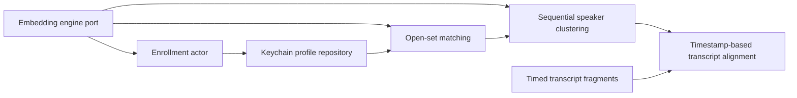

# Offline speaker recognition

## Repository audit

Wesley Flow is a native Apple Silicon macOS 26 SwiftUI app. `WesleyFlow.xcodeproj` builds the app and AppTests. `Packages/WesleyFlowCore` is a Swift 6.2 package with Domain, VoiceInput, Persistence, TaskExecution, SystemOperations, Workspace, CodingAgents and ModelProviders modules and module-specific tests.

- `AppleDictationInput` owns the English AVAudioEngine tap. `NativeSpeechCallbacks` bridges the native callback to `AudioIngress`, which downmixes, converts, queues modern SpeechAnalyzer input or feeds legacy on-device recognition. The modern path tracks timed recognition ranges.
- `TeluguDictationInput` owns its own tap when the Telugu provider is selected. `TeluguAudio`, `WhisperAudioWindows` and `LocalWhisperRecognizer` handle buffering, utterance windows and offline inference. The package pins whisper.cpp 1.8.2. Existing Telugu tools verify ASR weights.
- `AppComposition` wires providers into `SystemWideDictationCoordinator`. The coordinator consumes `DictationEvent`, drives `GlobalDictationView` and uses the existing insertion pipeline. `SwiftDataDictationHistoryStore` persists delivered dictations. `TaskCoordinator` and Domain task events serve task orchestration, with a separate SwiftData repository. Dictation events are the appropriate boundary for optional speaker annotations. Task events should not gain execution authority from voice labels.
- MainActor owns UI and provider lifecycle. Sendable callbacks and bounded ingress bridge native callback queues. Actor-owned storage and injected ports suit enrollment and matching.

## Foundation and integration sequence

This section records the initial isolated increment. The guided enrollment section below describes the later app wiring.

The foundation adds speaker contracts and matching to Domain, enrollment, identification and sequential clustering to VoiceInput, and Keychain persistence to Persistence. It remains disconnected from app composition pending a verified model and capture validation.



The existing Telugu energy gate now exposes a timed output in the 16 kHz session frame clock, including its preroll. Its ASR caller still receives the same PCM arrays. The next capture increment should attach an opt-in side channel to the selected provider's existing tap. Preallocate a bounded native-format buffer pool, preserve the tap sample position, and drop the speaker branch on overflow or discontinuity. Keep ASR delivery independent. A worker can downmix, resample, segment with a replaceable VAD and perform inference. Discard buffers at cancellation, permission loss or input-device change. Use a session ID and monotonic sample ranges for delayed labels. Align timed words by maximum overlap, then timed segments where only segment timings exist. Keep untimed text unattributed when a single interval cannot be established. Persist finalized labels separately from text, and add optional event metadata with no effect on insertion or privileged actions.

## Model decision and gates

Sherpa-onnx provides a macOS runtime and a speaker embedding C API with feature extraction and dimension discovery. WeSpeaker VoxCeleb ResNet34 is a candidate ONNX export. The upstream recipe takes 16 kHz audio, and its ResNet34 default uses 80-feature input and 256 output dimensions. Verify the actual exported graph and runtime frontend before pinning it. The publisher identifies VoxCeleb pretrained models as CC BY 4.0. Keep attribution and verify the provenance of the exact repackaged weights before redistributing. See [WeSpeaker pretrained models](https://github.com/wenet-e2e/wespeaker/blob/master/docs/pretrained.md). Using ONNX Runtime directly also requires reproducing and validating model-specific frontend processing. A verified Core ML conversion could avoid adding another native runtime, but requires feature and embedding parity tests. The isolated Swift probe pins the model by SHA-256 and was tested with sherpa-onnx 1.13.8 on Apple Silicon. The app does not link or redistribute this runtime or model. See [Sherpa-onnx speaker API](https://k2-fsa.github.io/sherpa/onnx/c-api/html/speaker_embedding.html) and [model releases](https://github.com/k2-fsa/sherpa-onnx/releases/tag/speaker-recongition-models).

Before wiring the model into the app, select and verify a signed native distribution of the pinned runtime and confirm model-specific redistribution terms. Require matching calibration for that exact artifact. Measure initialization, inference, peak memory and ASR impact, and calibrate rejection and ambiguity using held-out speakers and realistic microphones. No download should run from app startup or recognition.

Enrollment averages unit-normalized embeddings and normalizes the centroid. Profiles contain embeddings and metadata only. Keychain items are local and non-synchronizing. Device signing and Keychain behavior require a signed-app integration check. Speaker labels must never authorize privileged actions. Sequential clustering assigns stable IDs to pre-separated single-speaker segments using an explicitly supplied model-specific cutoff. It does not detect a speaker change inside one segment. Alignment requires a unique interval covering a strict majority of a timed fragment. Live capture fan-out, change detection, settings, history and workflow metadata remain follow-on integration. Overlap requires separately validated support.

## Running the fixtures

Run `xcrun swift test --package-path Packages/WesleyFlowCore --filter SpeakerRecognitionTests` with the full Xcode toolchain selected. The fixture engine uses deterministic vectors and the enrollment tests use an in-memory repository. These tests cannot measure speaker accuracy or validate signed-app Keychain access. Before enabling real enrollment, exercise create, read, update, delete and relaunch with a signed disposable app and an isolated Keychain service. The enrollment capture UI must obtain explicit consent and call `loadModel()` before recording. The engine must accept 16 kHz mono Float32 samples and return the exact artifact's embedding dimension.

## Native model probe

`Experiments/OfflineSpeaker/WeSpeakerEngine.swift` implements the Domain engine port through the sherpa-onnx C API. One Swift actor owns the CPU model context, verifies the artifact before loading, validates the runtime dimension and frees every stream and native embedding. Only the development probe links this adapter. The production app does not load it, request speaker consent or capture audio for it.

- Artifact: `wespeaker_en_voxceleb_resnet34.onnx`, 26.5 MB, from [revision 70503b6](https://huggingface.co/csukuangfj/speaker-embedding-models/blob/70503b6968275c19ba5bdcba8da82023ee73d9d8/wespeaker_en_voxceleb_resnet34.onnx).
- SHA-256: `5ef208a9da1453335308a6b6f4e6dfbd7e183a38b604de0a57664f45d257fe94`. The probe rejects a mismatch before creating the native model.
- Runtime: sherpa-onnx 1.13.8 C API and its bundled ONNX Runtime. See [sherpa-onnx license](https://github.com/k2-fsa/sherpa-onnx/blob/master/LICENSE) and [ONNX Runtime license](https://github.com/microsoft/onnxruntime/blob/main/LICENSE). The native libraries and model remain outside Git.
- Input and output: 16 kHz mono Float32 PCM, 256-dimensional embedding, normalized by the Swift adapter.

To reproduce, manually download the pinned ONNX file using the link above. Install the Apple Silicon wheels in an isolated Python 3.11 environment with `pip install sherpa-onnx==1.13.8`. The wheels are used as a source of C headers and libraries. Python does not run during recognition. With full Xcode selected, run the following from the repository root. Supply synthetic or consented mono PCM WAV files at 16 kHz.

```sh
bash Experiments/OfflineSpeaker/build_probe.sh /path/to/venv/lib/python3.11/site-packages/sherpa_onnx /tmp/wesley-probe
/usr/bin/sandbox-exec -p '(version 1)(allow default)(deny network*)' \
  /tmp/wesley-probe/probe /path/to/wespeaker_en_voxceleb_resnet34.onnx fixture.wav
```

The probe ran on arm64 macOS 27.2 with Xcode 27 and one CPU inference thread. With network access denied, checksum verification and initialization took 92–127 ms across two runs. Inference took 151–175 ms for two synthetic macOS voices of 5.83 and 5.25 seconds. Both yielded finite, nonzero 256-dimensional embeddings. Peak process RSS was 123–125 MiB, including the runtime and probe. A WAV substituted for the ONNX artifact was rejected with `artifactMismatch`. These are smoke measurements. They provide no calibration, false acceptance, false rejection, diarization error, live latency or ASR throughput result.

## Automated verification

- Full Swift package suite passed 387 test declarations, including seven speaker tests and the existing Apple and Telugu audio suites.
- The native Xcode Debug regression run passed 1,993 cases across 901 declarations with zero failures. The arm64 Release build with complete strict concurrency passed.
- The tests used synthetic audio and vectors for enrollment, matching, clustering and transcript alignment. Live microphone delivery, signed-app Keychain persistence, production packaging, real-speaker accuracy and live labeling are unverified.

## Guided speaker enrollment and saved dictation labels

The speaker-enabled local build adds **General → Speaker profiles**. Enter the speaker's name, confirm their consent, and use **Record sample** and **Finish sample** for each of three passages. Saving enables speaker labels. The switch controls whether future saved dictations use the speaker branch. **Keep dictation history** must also be enabled. Existing labels stay in history after deleting a voice profile. Clear individual history entries or clear history to remove those labels.

For English or Telugu dictation, the active ASR tap can feed an independent preallocated speaker ring. Resampling and inference run away from the tap. The speaker branch cannot supply text or change insertion behavior. Classification is attached to the finished history payload using its existing session ID. The payload's optional speaker field is backward compatible, so older entries appear as Unlabeled when a speaker filter is available. History stores a name and profile ID for a match, or Unknown speaker. It does not store embeddings or audio. Agent commands do not use speaker labels for authorization.

Enrollment samples stay in memory while being processed. Profiles use the local macOS login Keychain, compatible with the ad-hoc local build. Each profile uses the lower quartile of the pairwise enrollment similarities as a provisional cutoff. A recording must match exactly one enrolled profile to be labeled by name. Test the intended microphones, speakers and languages before relying on the labels. This policy has no measured false-accept or false-reject rate for human voices.

The current history label applies to one person speaking per Fn recording. There is no change detection inside an utterance. Interrupted, overlapping, very short, or longer-than-14-second captures may be Unknown or have an unreliable label. The recording and insertion still follow the normal dictation path.

Build a local speaker-enabled app from the signed Release bundle with:

```sh
bash Experiments/OfflineSpeaker/package_local.sh \
  "/path/to/Release/Wesley Flow.app" \
  "/path/to/venv/lib/python3.11/site-packages/sherpa_onnx" \
  "/path/to/wespeaker_en_voxceleb_resnet34.onnx" \
  "/path/to/staging/Wesley Flow.app"
```

Use the pinned 1.13.8 runtime and model checksum above. This step packages the two native libraries and the verified weights and signs the local bundle. It does not install dependencies, download weights, or launch the app. Standard Xcode builds run without speaker artifacts and show a setup error if enrollment is attempted. This packaging path is for a local ad-hoc app.

Verification used two synthetic macOS voices, each enrolled from the three displayed passages, plus a held-out passage from each and a third, unenrolled voice. With networking denied, the packaged native engine labeled the two enrolled voices by name and the third Unknown. The test used an isolated login Keychain service and verified saving, reading and deleting both profiles. Real microphone enrollment and person-level accuracy were not measured.
